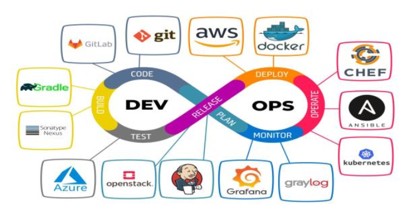

# Introducción a Devops

## Índice

[1.- Principios de Devops](1.md)

[2.- Fases de Devops](2.md)

[3.- Herramientas CI/CD](3.md)

[4.- Automatización de procesos](4.md)

## Webgrafía

*   **Página Oficial de git:** [https://git-scm.com/](https://git-scm.com/)
*   **Documentación oficial de git:** [https://git-scm.com/docs](https://git-scm.com/docs)
*   **Libro en español de git:** [https://git-scm.com/book/es/v2](https://git-scm.com/book/es/v2)
*   **Resumen git:** [https://training.github.com/downloads/es_ES/github-git-cheat-sheet/](https://training.github.com/downloads/es_ES/github-git-cheat-sheet/)
*   **Página oficial de Markdown:** [https://markdown.es/](https://markdown.es/)
*   **Página oficial de Github:** [https://github.com/](https://github.com/)
*   **Documentación oficial de Github:** [https://docs.github.com/es](https://docs.github.com/es)
*   **Ayuda a GitHub:** [https://support.github.com/](https://support.github.com/)
